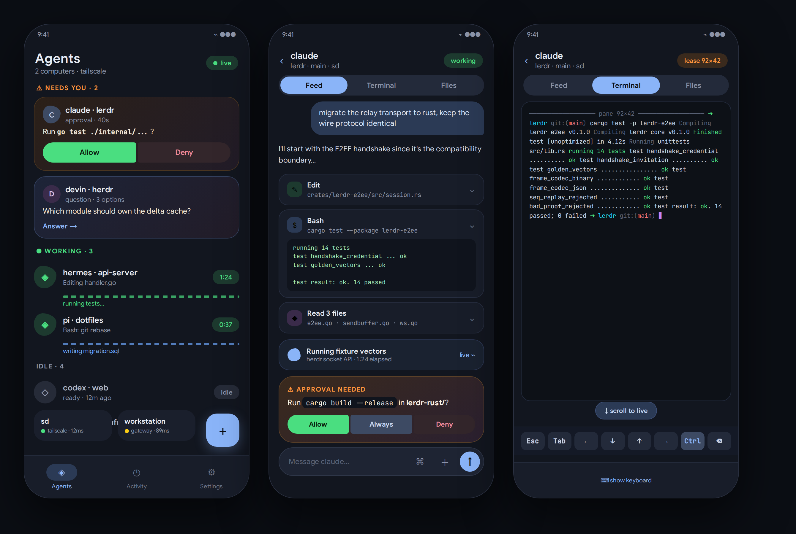

# lerdr

> **Status: 1.1.2.** Native Android app and Rust relay with the frozen
> `protocol v3` / `herdr-e2ee-v2` contract. This release does not imply full
> audit acceptance; see the [release limits](CHANGELOG.md#100--2026-10-04)
> and [specification gaps](docs/10-spec-gaps.md).

Your coding agents, live on your phone — sessions, questions, approvals,
terminals, and workspace files, over an end-to-end encrypted channel.

A **Rust relay** + **Kotlin / Jetpack Compose (Material 3 Expressive)
Android app** speaking `protocol v3` over `herdr-e2ee-v2`, backed by a
[Herdr](https://github.com/0cv/herdr) host. Remote transport: Tailscale.



## Why lerdr exists

Lerdr began with the idea of reaching coding agents from a phone, inspired
by [0cv/herdr-mobile-relay](https://github.com/0cv/herdr-mobile-relay).
My first take used a Go relay and a Tauri-based mobile app. With access to
Cognition's SWE-2, I used Rust and Kotlin — a stack new to me — to build
this independent relay and native Android experience with coding agents.
The product now centers on a semantic feed, interactive terminal, and
workspace controls; its own specifications and frozen fixtures define its
behavior. It is not a fork, and development does not depend on consulting
the earlier project's source.

The name: the iguana is an animal I've always found curious.

## What it does

- **Mission-control home** — agents grouped by workspace with
  working / attention / idle status, a needs-you rail with one-tap
  approvals, per-relay connectivity.
- **Session** — Feed (structured conversation, question and approval
  cards), Terminal (full ANSI pane, key bar, find), Files (workspace
  tree, preview, git status/diff).
- **Pairing** — QR or `lerdr://pair` deep link; biometric lock; device
  and relay management from Settings.
- **E2EE** — P-256 handshake + AES-GCM sealed frames between the phone
  and the relay, riding over Tailscale's WireGuard path.
- **Frozen wire contract** — `protocol v3` is anchored by committed
  golden vectors (`fixtures/`) and a determinism harness
  (`tools/shadow/`): two fresh relays against one fake Herdr must emit
  byte-identical normalized streams.

## Quick start

You need:

- [Herdr](https://github.com/0cv/herdr) ≥ 0.7.5 on macOS or Linux — the
  "computer" below.
- [Tailscale](https://tailscale.com/download) on the computer **and** on the
  Android phone, both signed in to the same tailnet. The phone reaches the
  relay only through the tailnet; there is no public endpoint.
- In the [tailnet DNS settings](https://login.tailscale.com/admin/dns):
  **MagicDNS** and **HTTPS Certificates** enabled.
- Linux only: let your user configure Tailscale Serve without `sudo`:

  ```sh
  sudo tailscale set --operator="$USER"
  ```

### 1 · Install the plugin — computer

```sh
herdr plugin install IGUNUBLUE/lerdr-rust-kotlin/plugin
```

Herdr clones the repo and runs the build hook, which downloads the
checksum-verified `lerdr-relay` release into `~/.local/share/lerdr/` and
links `~/.local/bin/lerdr-relay`. No Rust toolchain is needed. Herdr then
opens the **Lerdr: Setup** pane.

For omp, also install its [profile-scoped lifecycle integration](plugin/README.md#omp-lifecycle-status)
so working turns and in-process subagents do not appear idle.

### 2 · Start the relay, publish it, print the QR — computer

In the **Lerdr: Setup** pane choose **1 · Tailscale Serve**. If the pane is
closed, open it with:

```sh
herdr plugin action invoke setup --plugin lerdr.events
```

On the first run it does three things:

1. **Installs the relay as a background service.** It creates `relay.env`
   (relay token + instance id) in the plugin's config directory, installs
   the `lerdr.service` systemd user unit (Linux) or the `com.lerdr.service`
   LaunchAgent (macOS), and starts the relay on `127.0.0.1:8375`. Plugin
   upgrades keep this service up to date.
2. **Publishes it on your tailnet.** It runs `tailscale serve --bg 8375`,
   which exposes the relay at `https://<computer>.<tailnet>.ts.net` to
   your tailnet only. The first time, Tailscale may print an approval URL
   to enable Serve for your tailnet. Open it and approve, and the command
   continues.
3. **Prints the QR** and the private setup link once that HTTPS endpoint
   is healthy.

The QR contains the relay token. Do not share it or screenshots of it.
Each print arms a fresh one-shot invitation that pairs **one phone within
~10 minutes**.

On Linux, user services stop when you log out. To keep the relay running
while you are away from the computer:

```sh
loginctl enable-linger "$USER"
```

### 3 · Install the app — phone

Download `lerdr_<version>_universal.apk` from the
[latest release](https://github.com/IGUNUBLUE/lerdr-rust-kotlin/releases/latest)
and open it. Android asks once to allow installs from the source app.
After that, the app checks GitHub releases on its own and can update in
place (Settings → App update).

### 4 · Pair — phone

Make sure Tailscale is connected on the phone. Open Lerdr, go to the
pairing screen, and scan the QR from step 2 with the **in-app scanner**
(or paste the link). The phone shows `1 computer · live`.

### Pair another phone / reprint the QR

```sh
lerdr-relay pairing qr
```

Or use **2 · Show Phone Setup QR** in the Setup pane. Both read the running
service's real port and Tailscale Serve route (HTTPS or TCP), arm a fresh
invitation, and print the QR. Neither changes Tailscale, restarts the relay,
or revokes phones that are already paired.

### Troubleshooting

Start with **3 · Show Full Status** in the Setup pane, or
`herdr plugin action invoke status --plugin lerdr.events`.

| Message | Cause → fix |
|---|---|
| `The relay is not answering on 127.0.0.1:<port>` | The service is installed but stopped. Run the command printed below the message, then step 2 again. |
| `Tailscale Serve has no route to the relay` | Nothing publishes the relay on the tailnet yet. Do step 2. |
| `tailscale serve is already configured for a different target` | Something else already uses this machine's tailnet HTTPS listener. Lerdr will not replace it. Free it with `tailscale serve --https=443 off`, or add your own TCP route to the relay port (`tailscale serve --bg --tcp=<N> tcp://localhost:<port>`), which step 2 then uses as is. |
| `This node has no tailnet DNS name` | Enable MagicDNS (see "You need"). |
| Permission error from `tailscale serve` (Linux) | Run `sudo tailscale set --operator="$USER"`. |
| The app can't connect after scanning | Tailscale is off on the phone, or the invitation expired (>10 min or already used). Reprint the QR. |

## Build from source

### Relay

The binary lives in the `lerdr-coord` crate. `-p lerdr-relay` builds only a
library and produces no executable.

```sh
cd relay && cargo build --release -p lerdr-coord --bin lerdr-relay
```

To run the checkout's binary as the background service, run from the repo
root (Linux: `plugin/scripts/deploy-relay.sh` rebuilds and restarts it later):

```sh
LERDR_RELAY_BIN="$PWD/relay/target/release/lerdr-relay" \
    plugin/scripts/install-tailscale-service.sh
```

The installer keeps an existing service's `relay.env` (token, port); a first
install uses `herdr plugin config-dir lerdr.events`. Then continue with
step 2 of the quick start.

For local plugin development, `herdr plugin link plugin/` runs the actions
from this checkout. See [plugin/README.md](plugin/README.md#local-development-link).

### Foreground relay (tests only)

The interop and probe gates in [AGENTS.md](AGENTS.md#verification) use a
foreground relay on port 8377:

```sh
./relay/target/release/lerdr-relay serve \
    --host 127.0.0.1 --port 8377 --token <32-byte-secret>
```

A foreground relay is not a user service. `lerdr-relay pairing qr` and
the Setup pane cannot pair a phone against it.

### Android app

```sh
cd app && ./gradlew :app:assembleDebug   # JDK 17, Android SDK 37.2
```

### Releases

Tag `v<x.y.z>` and `.github/workflows/release.yml` builds
`lerdr-relay` tarballs (linux musl amd64/arm64, darwin amd64/arm64),
`checksums.txt`, and the universal APK (signed when keystore secrets
are configured). See [docs/release.md](docs/release.md).

## Contributing

Contributions welcome — including AI-assisted ones (disclose them; see
[CONTRIBUTING.md](CONTRIBUTING.md)). Bugs and ideas go through the issue
templates; security reports through
[private vulnerability reporting](SECURITY.md). Releases are tracked in
[CHANGELOG.md](CHANGELOG.md).

## Acknowledgements

Thanks to the creators of
[0cv/herdr-mobile-relay](https://github.com/0cv/herdr-mobile-relay)
for the original inspiration, and to
[Herdr](https://github.com/0cv/herdr) for the host integration.

## License

MIT — see [LICENSE](LICENSE).
